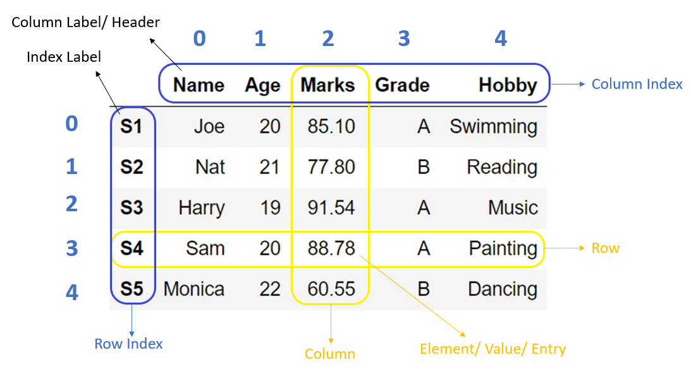
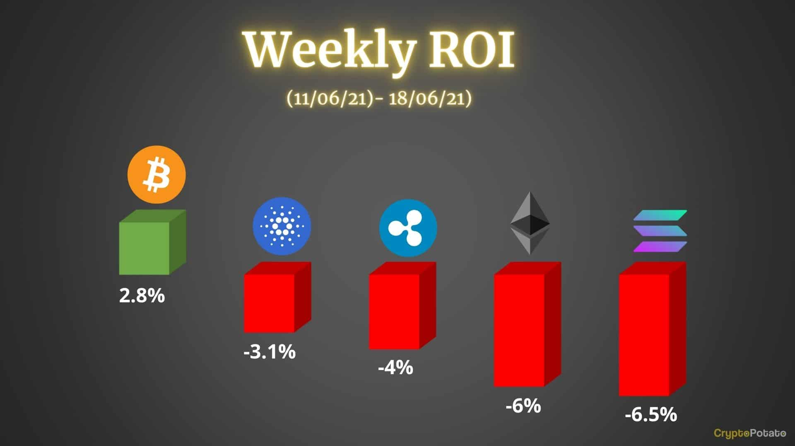
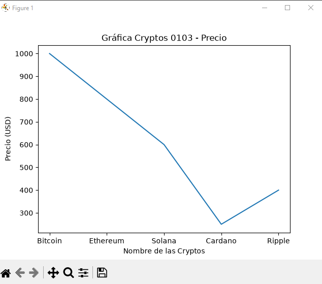
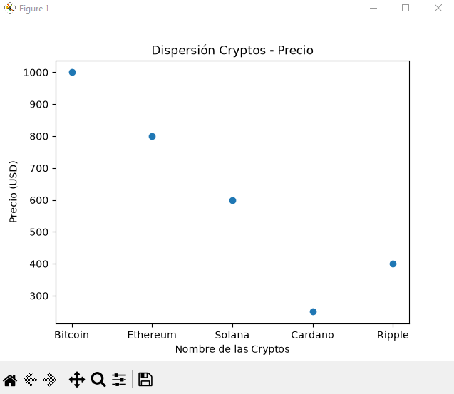
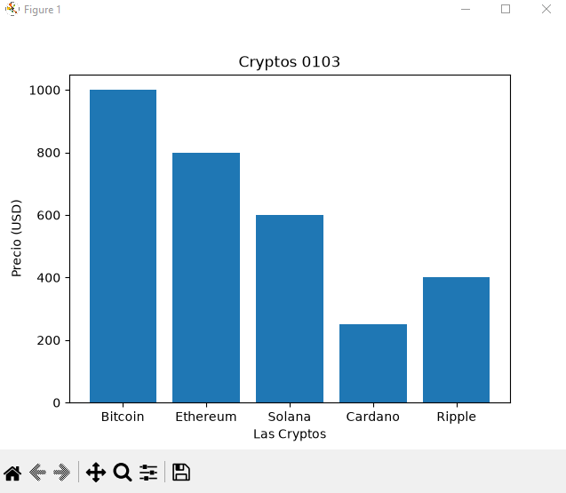
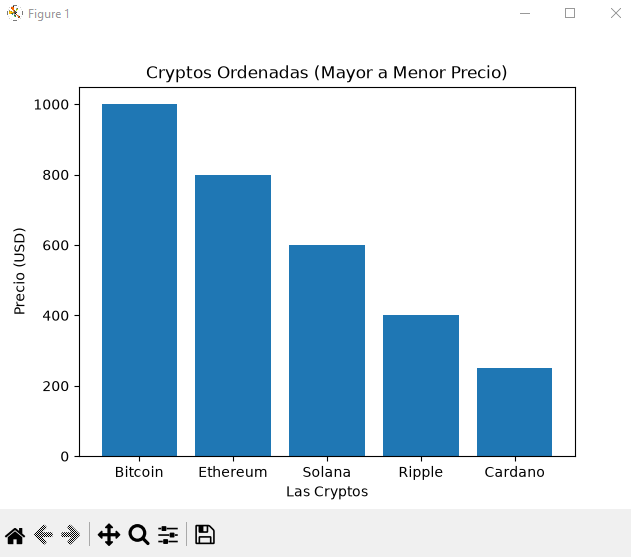
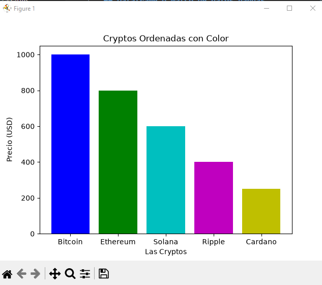
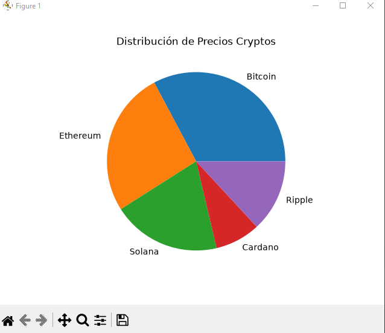

## Dataframe o matco de datos pandas

## Cryptomonedas a nivel mundial

## Grafica de Cryptomonedas

## Grafica de Cryptomonedas puntos

## Grafica de Cryptomonedas barras

## Grafica de Cryptomonedas barras ordenadas

## Grafica de Cryptomonedas barras colores

## Grafica de Cryptomonedas pastel
